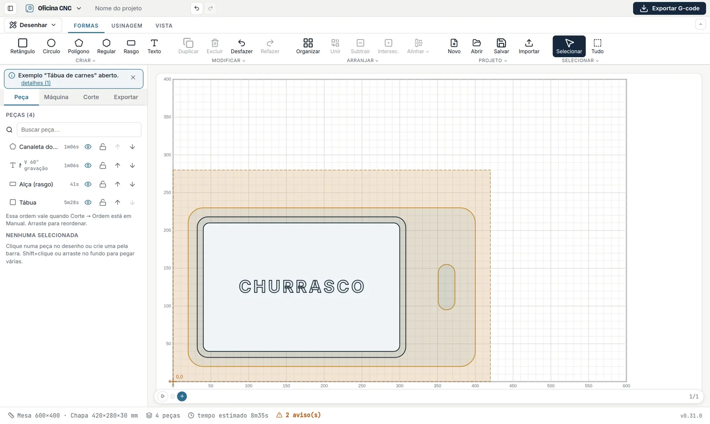
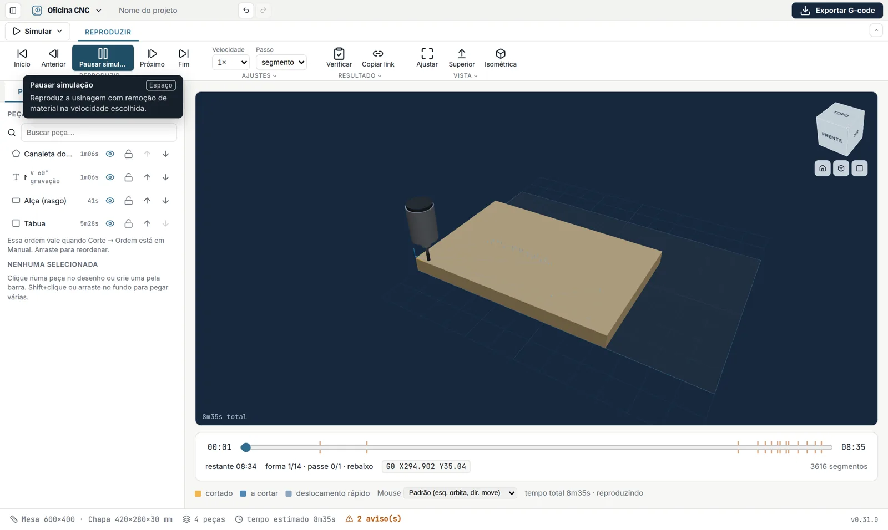

# Oficina CNC

[](https://github.com/kleberandrade/cnc-router/actions/workflows/ci.yml)
[](https://nodejs.org/en/download)
[](https://www.typescriptlang.org/)
[](https://react.dev/)
[](https://vite.dev/)
[](LICENSE)

**Oficina CNC** is a browser-based CAD/CAM workshop for hobby and small-workshop CNC
routers, created by **Kleber Andrade**. Draw parts, configure stock and tooling,
preview toolpaths in 3D, and export G-code for GRBL, Marlin or LinuxCNC/Mach3.
The product interface is in Brazilian Portuguese; contributor documentation is in English.

[Open Oficina CNC](https://cnc-router-ten.vercel.app/app/)

The editor and CAM engine run locally in the browser. Optional feedback uses a
Vercel Function and private Blob storage; analytics and performance integrations
are also included. No account is required. The source is publicly available on
[GitHub](https://github.com/kleberandrade/cnc-router); see the completed
[publication review](docs/security-review.md).

## Screenshots

Draw and arrange parts in the 2D editor, with stock, dimensions and machining settings.



Preview the toolpath and material removal in the 3D simulator before exporting G-code.



## Requirements

- Node.js **26.13.1** (recommended, `.nvmrc`) or supported Node **24.22.3+** within v24.
- npm **11+**; use npm and the committed `package-lock.json`.
- A modern browser with Canvas, Web Workers and WebGL. Playwright uses Chromium.
- Git for cloning.

## Install and quick start

```bash
git clone https://github.com/kleberandrade/cnc-router.git
cd cnc-router
npm ci
npm run dev
```

If you manage Node with nvm, run `nvm install` and `nvm use` inside the repository
before `npm ci`; otherwise install a supported Node version directly.

Open [the local app](http://localhost:5173/app/) (the root URL serves the landing page).
No environment variables are needed for drawing, simulation or G-code export.
For a production build and local preview:

```bash
npm run build
npm run preview
```

Open [the preview app](http://localhost:4173/app/). `dist/` contains static assets;
`api/feedback.ts` requires a separate Vercel Function runtime. Vite does not serve it.
Git-triggered Vercel deployments are disabled in `vercel.json` to keep source/CI
publication separate from deployment. The owner can re-enable `git.deploymentEnabled`
when a deployment is explicitly intended.

## Use the workshop

1. In **Desenhar**, open **Exemplos…** or add a rectangle/circle using the ribbon.
2. In the side panel, set **Máquina** (work area, stock, thickness and origin).
3. Under **Usinagem**, choose the material, tool, feed, spindle speed and pass depth.
   Internal geometry is in millimetres; export can use millimetres or inches.
4. Choose outline, pocket, engraving or drilling; inspect validation notices.
5. Switch to **Simular**, inspect the toolpath and stock removal, then **Exportar**.
6. Save a project JSON from the menu. Local browser storage is convenient persistence,
   not a backup. A shared project URL contains the project in its fragment; recipients
   can read it. User-installed fonts do not travel with JSON or share links.

DXF/SVG imports show a preview with layer, unit and hole-inference controls. PNG/JPEG
can become traced silhouettes or 2.5D reliefs. The gallery contains 14 examples,
including finger joints, a phone stand, a cutting board and image-based machining.
The **Folha técnica** workspace provides dimensioned sheets and printing; **Resistência**
provides indicative structural analysis, including glued touching parts.

## Executable examples

Generate a 40 × 30 mm, 3 mm deep rectangular pocket without opening a browser:

```bash
npm run --silent example > /tmp/oficina-example.gcode
```

The [example source](examples/generate-gcode.ts) calls the same pure CAM engine as
the app. It only writes text to stdout and never opens a serial port or sends commands.
[Sample programs](docs/samples/README.md) cover compensation, tabs, ramps, drilling,
post-processors and reliefs. Generated G-code is a simulation/reference artifact;
review it for the actual machine, tool, workholding and controller before machining.

## Tests and quality

```bash
npm run lint
npm run test
npm run test:coverage
npm run build
npx playwright install chromium
npm run test:e2e -- --workers=1
npm audit --audit-level=moderate
```

Coverage gates are **82% statements/lines, 80% functions, 77% branches**. Konva's
Editor and the WebGL Simulator are excluded from unit coverage because jsdom cannot
render them; browser tests cover those flows. E2E projects include desktop Chromium,
Pixel 7 and iPad emulation. Build before running E2E: the runner serves `dist/`.
For an existing Chromium, set `PW_CHROMIUM_PATH` to its absolute executable path.

[CI](.github/workflows/ci.yml) runs unit coverage, lint, dependency auditing, the
executable example, production build and Chromium E2E on pushes to `main` and PRs.
The CI badge shows the latest workflow result on `main`.
See the [maintenance log](docs/maintenance-log.md) for actual local results and limits.

## Architecture and contributing

- `src/lib/`: pure geometry, toolpaths, G-code, import/export, verification and FEA.
- `src/workers/`: derived CAM calculations and structural solver off the UI thread.
- `src/state/`: project, UI and simulation stores (Zustand/zundo).
- `src/components/`: React, Konva editor and lazy-loaded Three.js simulation.
- `src/content/`: examples, product identity and in-app policies.
- `api/`: optional feedback HTTP handler and independently testable core.
- `examples/`, `docs/samples/`: executable reference programs.

Read [AGENTS.md](AGENTS.md) for project conventions, [development](docs/development.md)
for testing and data flow, [feedback](docs/feedback.md) for the optional backend, and
[limitations](docs/limitations.md) before interpreting simulation or analysis results.
The [changelog](CHANGELOG.md) and historical [sprint plans](docs/sprints/README.md)
preserve earlier Portuguese records; they describe past work rather than current setup.

## License and attribution

Original code and documentation: [MIT](LICENSE), © 2026 Kleber Andrade.
Third-party software and fonts retain their licenses; see
[THIRD_PARTY_NOTICES.md](THIRD_PARTY_NOTICES.md). MIT does not grant rights to third-party
trademarks, artwork or user-imported designs. Author: [kleberandrade.dev](https://kleberandrade.dev).
