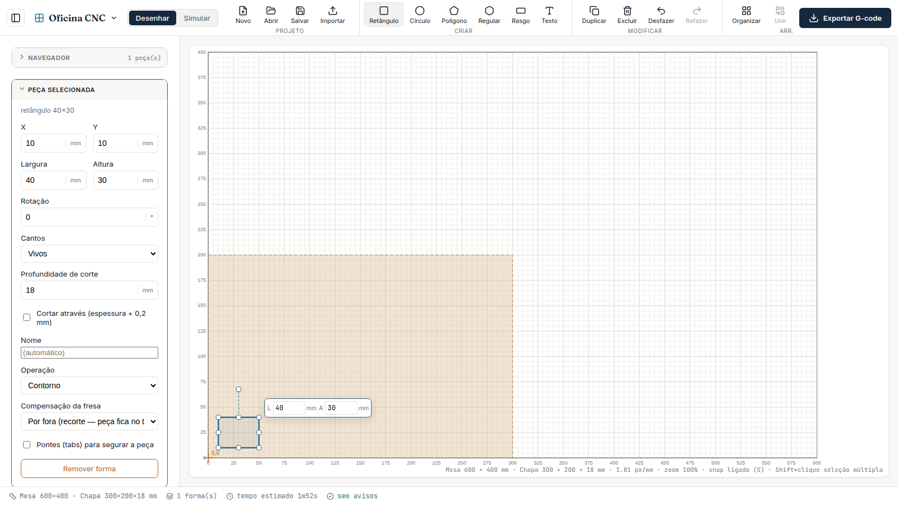
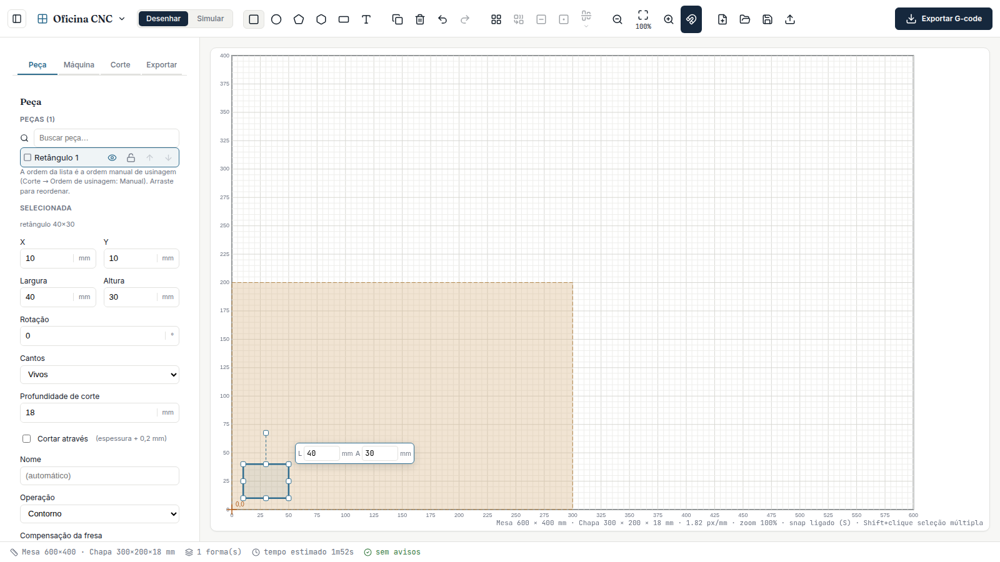
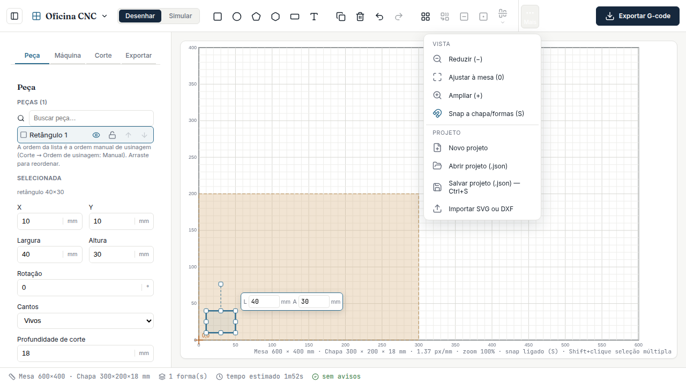

# Sprint 18 — Painel lateral, ribbon e escala tipográfica

**Status:** concluída — 2026-08-16
**Esforço:** M (4–5 dias)
**Depende de:** —

## Objetivo
Menos rolagem, menos repetição e nada cortado: painel com 4 abas, ribbon que se adapta à largura sem esconder ações, tipografia compacta e consistente.

## Antes / depois (1600 px)
| Antes | Depois |
|---|---|
|  |  |

1280 px com o menu **Mais ▾** aberto: 

## O que mudou
- **Tokens** (`index.css`): `--fs-xs 10.5 / --fs-sm 11 / --fs-md 12 / --fs-base 13 / --fs-lg 14`, `--control-h 30`, `--topbar-h 60`. Painel: rótulos 12 px, campos e selects 13 px, títulos de grupo 11 px; ribbon 10,5 px; mobile mantém 16 px nos inputs.
- **Painel** (`SidePanel.tsx`): acordeão de 8 seções → **4 abas** fixas no topo (`role=tablist`): **Peça** (navegador compacto + propriedades da seleção), **Máquina** (área útil + chapa/origem), **Corte** (material e fresa padrão, outras fresas, parâmetros, rampa/hélice/furação, ordem), **Exportar** (movimento G0/altura segura/aceleração, pós-processador, unidades). Subgrupos com título; `NumberField` ganhou `hint`. `uiStore.setSection` aceita os ids antigos (`navigator/stock/material/tools`) e mapeia para a aba certa.
- **Ribbon** (`Ribbon.tsx`, `OverflowRibbon`): grupos declarados como dados com prioridade (Criar 1 › Modificar 2 › Arranjar 3 › Vista 4 › Projeto 5); `ResizeObserver` mede a largura disponível e (1) mostra tudo com rótulos, (2) se não couber passa para **modo compacto** (só ícones, tooltips), (3) se ainda não couber move os grupos de menor prioridade para o menu **Mais ▾** — mesmas ações e `data-testid`. A ribbon nunca rola nem corta. **Alinhar/Distribuir** virou um botão com dropdown dentro de Arranjar (em vez de 8 botões contextuais).
- **Textos**: opções de select encurtadas ("Por fora (recorte)", "Por dentro (furo)", "Na linha (gravação)", "Polegadas (G20)"), checkbox "Cortar através" com hint, rótulos longos viraram rótulo + hint ("Rampa de entrada — 0 = mergulho vertical", "Furação: bicada"), rótulos da ribbon com `ellipsis` + `title`, título de grupo com `title`.
- **Testes**: `Ribbon.test.tsx` (mostra tudo quando cabe, overflow por prioridade com mesmos test ids, dropdown), e2e `layout.spec.ts` (1024/1280/1440/1920: nenhum botão fora do viewport, ações escondidas aparecem no Mais, 4 abas sem texto cortado, nenhum select com texto cortado, abas trocam de seção), `e2e/helpers.ts` (`ribbonClick`, `alignClick`).

## Tarefas
- [x] Escala tipográfica e alturas nos tokens; aplicada em painel, ribbon, menus, diálogos.
- [x] Painel em 4 abas com aliases dos ids antigos; abrir a aba certa por contexto (selecionar peça → Peça — já existia via `setSection("shape")`).
- [x] Ribbon com prioridade, modo compacto e overflow "Mais ▾" via `ResizeObserver`; testado em 1024/1280/1440/1600/1920.
- [x] Varredura de textos cortados/longos (selects, checkboxes, rótulos, resumos).
- [x] Testes unit + e2e; screenshots antes/depois em `docs/sprints/img/`.
- [ ] Snapshot visual (`toHaveScreenshot`) — adiado: o ambiente de CI/local (swiftshader) gera diferenças de antialias; fica para a Sprint 21 junto com axe.

## DoD específica
- ✅ Em 1280 × 720 todas as ações da ribbon estão acessíveis (Criar/Modificar/Arranjar visíveis; Vista/Projeto no Mais); em 1600 nada é cortado (tudo visível em modo compacto ou com rótulos).
- ✅ Painel com 4 abas; nenhum select/aba com texto cortado (teste automatizado); inputs numéricos com a mesma largura por coluna.
- ✅ Fontes ≤ 13 px no desktop; contraste mantido (tokens de tema inalterados).
- ✅ 266 unitários, 69 e2e (+1 pulado).

## Notas de fechamento
- Em 1440 px o modo compacto ainda não comporta Vista+Projeto (faltam ~10 px) — ficam no Mais; os atalhos (+/−/0/S) e o menu do projeto cobrem tudo. Ajuste fino de larguras pode vir com o feedback.
- A ribbon do simulador não usa o `OverflowRibbon` (poucos grupos; cabe em 1024).
