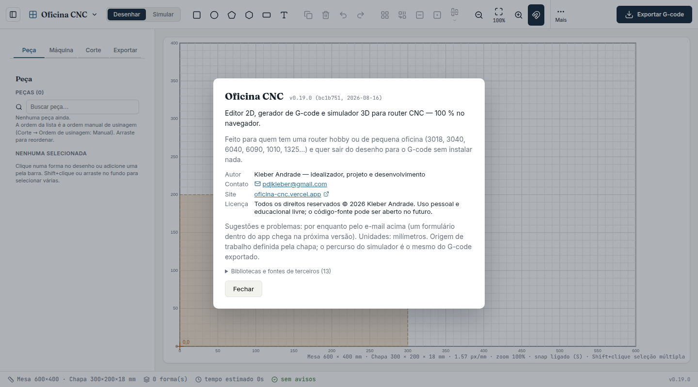

# Sprint 19 — Produto: versão, Sobre, novidades

**Status:** concluída — 2026-08-16 · **Versão:** 0.19.0
**Esforço:** P (2 dias)
**Depende de:** —

## Objetivo
Saber sempre qual versão está rodando (usuário e autor), apresentar o produto e o autor, e avisar quando há versão nova.

## Modelo
- `package.json` `version` = **0.19.0**. Regra: cada sprint fechada sobe o **minor** (Sprint 20 → 0.20.0…), correções → patch; `git tag vX.Y.Z` no fechamento.
- `vite.config.ts` `define`: `__APP_VERSION__` (package.json), `__GIT_SHA__` (`VERCEL_GIT_COMMIT_SHA` no deploy, `git rev-parse` local, `dev` sem git), `__BUILD_DATE__`, `__CHANGELOG__` (as 6 últimas seções `## […]` do `CHANGELOG.md`, lidas no build). Tipos em `vite-env.d.ts`.
- `src/lib/version.ts`: `APP_VERSION`, `GIT_SHA`, `BUILD_DATE`, `CHANGELOG`, `versionLabel()` (`v0.19.0`), `buildLabel()` (`v0.19.0 (abc1234, 2026-08-16)`), `isFirstRun` / `isNewVersion` / `markVersionSeen` (`localStorage oficina-cnc:seen-version`).
- `src/content/about.ts`: `PRODUCT` (nome, tagline, público, URL, licença), `AUTHOR` (**Kleber Andrade**, `pdjkleber@gmail.com`), `THIRD_PARTY` (13 bibliotecas/fontes com licença e link).

## Onde a versão aparece
1. Menu do projeto (rodapé `Oficina CNC v0.19.0`);
2. **Sobre** (`v0.19.0 (sha, data)`);
3. Rodapé do editor (`v0.19.0`, tooltip com o build);
4. Cabeçalho do G-code: `; Generated by Oficina CNC v0.19.0 (sha) — Kleber Andrade — https://oficina-cnc.vercel.app`;
5. Aviso do PWA: "Nova versão do Oficina CNC disponível (você está na v0.19.0)".

## Tarefas
- [x] Versão nos 5 lugares acima; `manifest.id`.
- [x] Sobre reescrito: o que é, para quem, autor + contato (mailto com assunto), site, licença, bibliotecas de terceiros (expansível).
- [x] **Novidades**: diálogo com as 3 últimas sprints do CHANGELOG (itens de primeiro nível); item de menu "Novidades" com marcador **novo** + ponto na marca quando a versão mudou desde a última visita; primeira visita não marca.
- [x] PWA: banner de atualização mostra a versão atual (o `updateSW` já existia).
- [x] README: seção "Sobre o projeto e o autor", política de versionamento.
- [x] Testes: `version.test.ts` (labels, primeira visita/versão nova, cabeçalho do G-code), `TopBar.test.tsx` (versão no menu/rodapé/Sobre, badge de novidades some ao abrir), e2e `about.spec.ts`. Total: 271 unitários, 70 e2e.
- [x] Esc fecha os diálogos do menu.

## DoD específica
- ✅ A versão aparece nos lugares listados e bate com o `package.json`.
- ✅ Sobre mostra autor, contato e licenças; Novidades lista as 3 últimas sprints.
- ⏳ `git tag v0.19.0` — fazer no Mac ao commitar (`git tag v0.19.0 && git push --tags`).

## Notas de fechamento
- `PRODUCT.repository` está vazio (repositório privado); preencher quando/se abrir o código.
- Licença: "Todos os direitos reservados… uso pessoal e educacional livre" como placeholder — decidir uma licença formal (MIT/AGPL) quando o repositório for público.
- Em testes unitários os `define` não existem: `version.ts` cai para `0.0.0-test`/`dev`.
