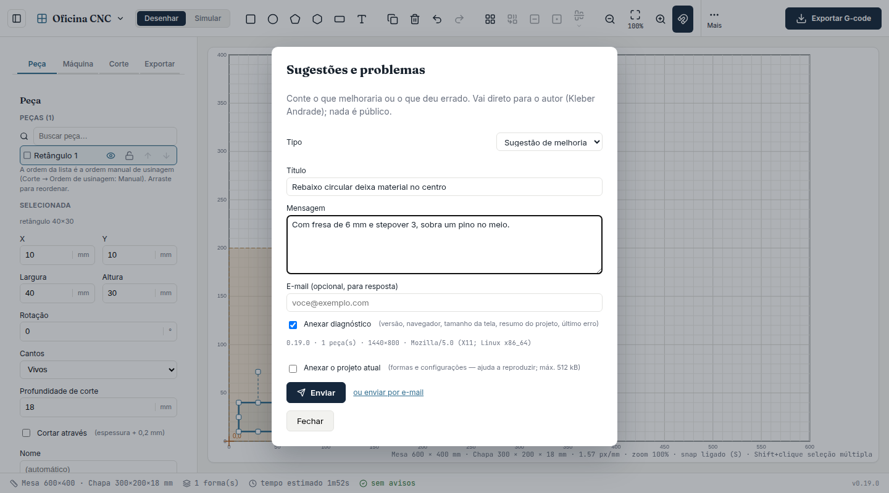

# Sprint 20 — Sugestões e problemas (Vercel Function + Blob)

**Status:** concluída — 2026-08-16 · **Versão:** 0.20.0
**Esforço:** M (3–4 dias)
**Depende de:** 19

## Objetivo
Qualquer pessoa consegue mandar uma sugestão ou reportar um problema de dentro do app, com diagnóstico anexado, sem criar conta; o autor lê tudo no Vercel.

## Arquitetura (implementada)
- `api/feedback.ts` (Vercel Function, Web `Request`/`Response`) → `api/_lib/feedback-core.ts` (`handleFeedback(req, deps)`: validação, honeypot, rate limit 5/min por IP com `Retry-After`, CORS por lista de origens, corpo ≤ 1 MB, grava via `deps.save`) → **Vercel Blob** privado `feedback/AAAA-MM/<ISO>-<tipo>-<id>.json` (`@vercel/blob` `put`, `access: "private"`). Sem `BLOB_READ_WRITE_TOKEN` → 501.
- `vercel.json` (`maxDuration 10`, `memory 256`), `.env.example`.
- Cliente `src/lib/feedback.ts`: `buildDiagnostics` (anônimo), `buildPayload` (honeypot vazio, e-mail opcional, projeto ≤ 512 kB), `sendFeedback` (timeout 12 s; mapeia 501/404 → indisponível, 429 → limite, 4xx → rejeitado, rede) e `mailtoFor`; buffer dos últimos 5 erros (`installErrorCapture` no `main.tsx`).
- `FeedbackDialog.tsx`: menu → "Sugestões e problemas…", link no Sobre; tipo, título, mensagem, e-mail opcional, anexar diagnóstico (com prévia) / projeto, estados enviando / enviado (id) / erro com `mailto:`, offline recusado com mensagem.
- `scripts/feedback-report.ts`: lista os envios (tabela ou `--json`). `docs/feedback.md`: ativação, leitura, LGPD, dev local.

## Tarefas
- [x] `api/feedback.ts` + core testável + `vercel.json` + `.env.example`.
- [x] `lib/feedback.ts` + `FeedbackDialog.tsx` + entradas no menu e no Sobre.
- [x] Estados enviando/enviado/erro/offline com fallback `mailto:`.
- [x] `docs/feedback.md` (ativar Blob, ler, retenção/LGPD).
- [x] Testes: 7 do core (validação, 400/405/403/413, honeypot, 429, janela, CORS, 502), 4 do cliente, 3 e2e (sucesso com payload conferido, 501 → e-mail, offline). Total: 284 unitários, 74 e2e.

## DoD específica
- ✅ Função rejeita corpo > 1 MB (413) e o 6.º envio no minuto (429) — testes.
- ✅ Sem token o app oferece o `mailto:` — nunca falha em silêncio (e2e 501).
- ✅ `docs/feedback.md` permite ler os envios em < 5 min (dashboard ou script).
- ⏳ **Enviar em produção cria o JSON no Blob** — depende de criar o Blob store no projeto Vercel (passo 1 do doc) e redeploy; verificar após o deploy.

## Notas de fechamento
- Rate limit em memória é por instância da função (suficiente contra acidentes; não é proteção forte).
- `vite preview` não serve `/api` → localmente o formulário cai no e-mail (esperado); `vercel dev` roda a função.
- E-mail automático ao autor (Resend) fica para quando houver volume.
