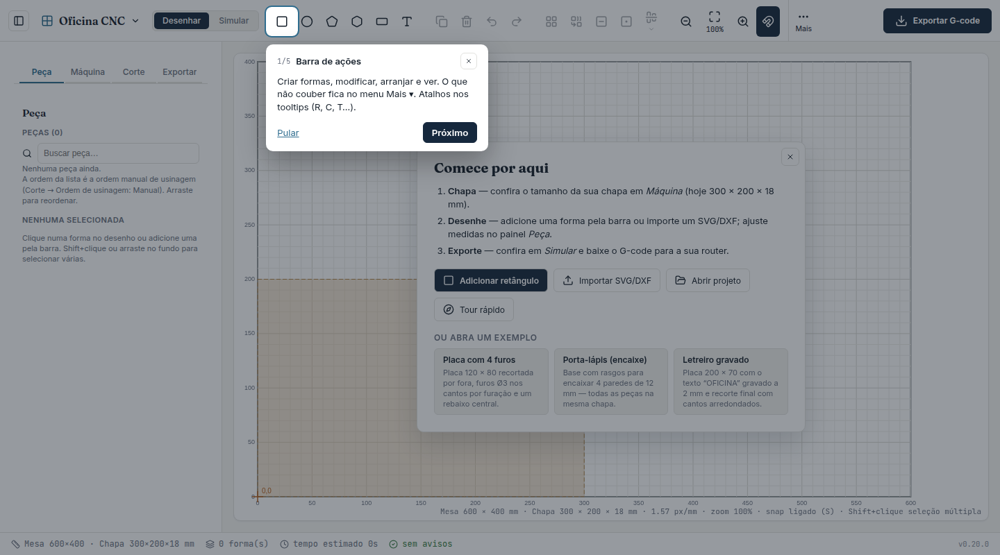
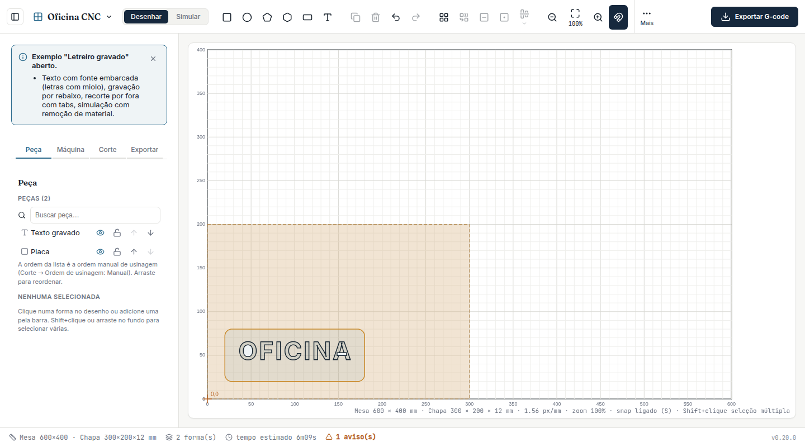

# Sprint 21 — Usabilidade: primeiro uso, exemplos, acessibilidade, preferências

**Status:** concluída — 2026-08-16 · **Versão:** 0.21.0
**Esforço:** M (4–5 dias)
**Depende de:** 18

## Objetivo
Alguém que nunca viu o app consegue, em 5 minutos, desenhar uma peça, entender o que vai acontecer e exportar — e usuários de teclado/leitor de tela não ficam presos.

| Tour (1.ª visita) | Exemplo aberto |
|---|---|
|  |  |

## O que mudou
- **Estado vazio** (`EmptyState.tsx`): card "Comece por aqui" sobre o editor enquanto não há formas — 3 passos (chapa → desenhar → exportar), botões (adicionar retângulo, importar SVG/DXF, abrir projeto, tour) e os **3 exemplos**; fecha no X, some ao criar a 1.ª forma ou ao ativar a ferramenta polígono; não aparece no mobile.
- **Exemplos** (`content/examples.ts`, também no menu do projeto): *Placa com 4 furos* (recorte por fora + furação com bicadas + rebaixo, cantos arredondados, tabs), *Porta-lápis (encaixe)* (rasgos por dentro, 5 peças, tabs — bom para testar Organizar), *Letreiro gravado* (texto Inter Bold gravado a 2 mm com hélice, recorte por fora). Cada um valida sem erro, gera G-code e cabe na chapa (teste).
- **Tour** (`Tour.tsx`): 5 balões ancorados (barra, painel, mesa/chapa, Simular, Exportar) com destaque do alvo, teclado (←/→/Enter/Esc), "Pular"; abre sozinho na 1.ª visita em desktop, `oficina-cnc:tour-done`; reabrível pelo menu ("Tour rápido").
- **Acessibilidade**: `@axe-core/playwright` nas vistas editor (com forma, aba Corte, Sobre), vazio e simulador → **0 violações sérias/críticas** (incluindo contraste): corrigido `nested-interactive` no navegador (itens deixam de ser `option` com botões dentro; seleção via `aria-current`), `--muted` escurecido para AA (4,5:1 em 12 px), versão do rodapé sem opacidade. Diálogos fecham com Esc (Sprint 19); foco visível já existia.
- **Preferências**: **Densidade** (compacta / confortável — controles 36 px, mais espaço) e **Tamanho do texto** (pequeno / normal / grande) via `data-density` / `data-text` no `<html>` (tokens `--fs-*`, `--control-h`), persistidos.
- **Testes**: `Onboarding.test.tsx` (estado vazio, tour, prefs), `examples.test.ts`, e2e `onboarding.spec.ts` (tour 1.ª visita/pular/menu, exemplos, fechar card, prefs persistem), `a11y.spec.ts`; Playwright agora inicia com o tour marcado como feito (`storageState`) para não bloquear os outros testes. Total: 291 unitários, 79 e2e.

## Tarefas
- [x] Estado vazio com 3 passos, botões e exemplos.
- [x] Tour curto opcional na primeira visita + menu.
- [x] Acessibilidade WCAG AA com axe (0 sérias/críticas nas 3 vistas), Esc nos diálogos, contraste.
- [x] Preferências de densidade e tamanho de fonte.
- [x] Testes unit + e2e.
- [~] Mensagens: o tom de copy foi revisado pelo autor em paralelo (`AGENTS.md` / regra de copy) — não refeito aqui para não conflitar.
- [ ] Teste com 2 pessoas (roteiro `docs/ux/roteiro-teste.md`) — **a fazer pelo autor**; roteiro sugerido abaixo.
- [ ] Mobile: gestos e alças já cobertos pelas sprints 08/18; sem mudanças nesta.

## Roteiro de teste com usuário (5 min)
1. Abrir o app pela primeira vez; seguir (ou pular) o tour.
2. "Faça uma placa de 100 × 60 com um furo de 8 mm no meio e exporte o G-code para GRBL."
3. Observar: encontrou a chapa? entendeu "por fora/por dentro"? achou Simular e Exportar? Anotar travas e mensagens confusas → Sugestões e problemas.

## DoD específica
- ✅ Exemplos abrem em 1 clique e simulam (e2e/unit).
- ✅ axe: 0 violações críticas/sérias; navegação por teclado no tour, menus e diálogos.
- ⏳ Teste com 2 pessoas — depende do autor.
