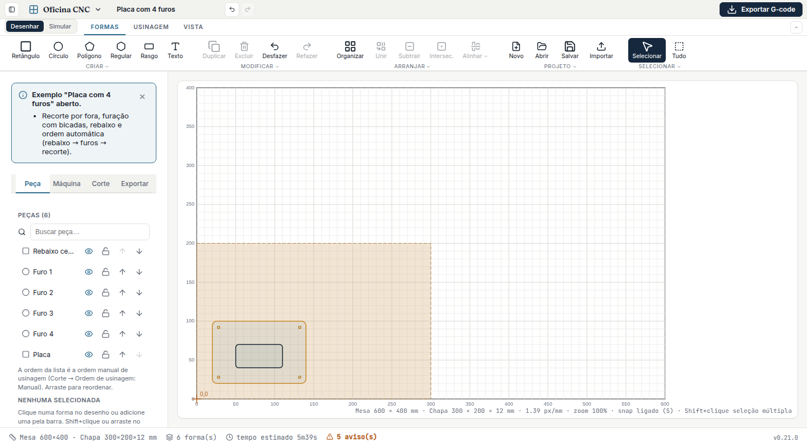
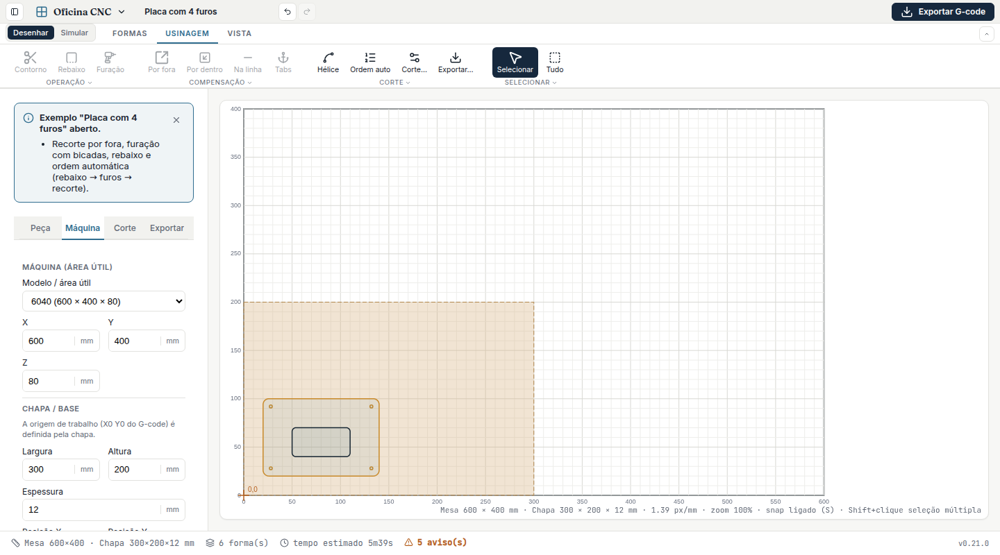

# Sprint 22 — Barra superior no estilo Fusion 360

**Status:** concluída — 2026-08-16 · **Versão:** 0.22.0
**Esforço:** M (4–5 dias)
**Depende de:** 18

## Referência (Fusion 360)
Nas capturas de referência a barra do Fusion tem **quatro camadas** bem separadas:
1. **Barra de aplicação** (fina, ~28 px): grade de apps, arquivo ▾, salvar, desfazer/refazer à esquerda; **abas de documentos** ao centro (nome + ×, "+"); à direita ícones de nuvem/notificações/ajuda e o avatar.
2. **Workspace + abas de contexto** (~24 px): botão **DESIGN ▾ / MANUFACTURE ▾** (muda o espaço de trabalho — no nosso caso *Desenhar / Simular*) e as **abas do espaço** em caixa alta (SOLID · SURFACE · MESH · SHEET METAL · PLASTIC · UTILITIES / MILLING · TURNING …) — a aba ativa sublinhada em azul.
3. **Ribbon** (~64 px): grupos de ícones grandes (32 px) com **rótulo do grupo embaixo em caixa alta com ▾** (CREATE ▾, MODIFY ▾, ASSEMBLE ▾…). Cada rótulo de grupo abre um **menu vertical completo** do grupo (ícone + nome + atalho à direita, ex.: *Extrude E*, *Hole H*) com **tooltip rico** ao pairar (título, descrição de 1–2 linhas, ilustração/GIF, "Press Ctrl+/ for more help"). O primeiro botão do grupo é a ação "primária" grande; os demais são ícones pequenos; separadores verticais entre grupos; **SELECT** sempre no fim, à direita.
4. **Barra de navegação inferior** flutuante (órbita, pan, zoom, ajustar, exibição, grade) — nós já temos ViewCube + Vista; fica como opcional.

Diferenças a preservar: somos web e mm; não temos "documentos" abertos em abas (temos 1 projeto) — a linha 1 vira uma **barra de app compacta** com projeto (nome editável do projeto + estado salvo/alterado), desfazer/refazer, e à direita versão/novidades/feedback/ajuda; sem avatar.

## Proposta (o que fazer)
- **Linha 1 — App bar** (28 px): marca (BrandMark), menu ▾ (o `ProjectMenu` atual), **nome do projeto** editável (`settings.projectName`, usado no arquivo `.json`, no cabeçalho do G-code e no `document.title`) com indicador • de não salvo (comparar hash do último salvamento), Undo/Redo, e à direita: **Exportar G-code** (primário), ícone de novidades (ponto), ajuda (atalhos), feedback.
- **Linha 2 — Workspace + abas** (26 px): botão **DESENHAR ▾ / SIMULAR ▾** (dropdown com os dois espaços e descrição), abas em caixa alta por espaço:
  - Desenhar: **FORMAS** (Criar/Modificar/Arranjar/Alinhar), **USINAGEM** (operação/compensação/tabs/hélice/furação da peça selecionada + material/fresa — atalhos para o painel), **VISTA** (zoom, snap, grade, réguas, tema).
  - Simular: **REPRODUZIR** (transporte, velocidade, modo de passo), **VISTA** (ajustar, superior, iso, ortográfica, mouse), **RESULTADO** (tempo, avisos, exportar).
- **Linha 3 — Ribbon**: reaproveita `OverflowRibbon` (prioridade, compacto, Mais ▾), com **rótulo do grupo clicável (▾)** abrindo o **menu vertical do grupo** (todas as ações do grupo, com atalho à direita e estado desabilitado) — o `RibbonGroupDef.items` já tem tudo; ícones 22–24 px; primeiro item de cada grupo em destaque ("primário"); **Selecionar** (seta) fixo à direita como no Fusion, com dropdown (janela / laço / por tipo).
- **Tooltip rico** (`RichTooltip`): título + atalho, 1–2 linhas de descrição, ilustração SVG pequena (reutilizar os ícones grandes ou mini-diagramas 96 × 64 desenhados em SVG para as ações de criar/modificar), aparece após 600 ms, some ao mover; acessível (`aria-describedby`), sem bloquear cliques.
- **Tokens/estilo**: fundo claro `--surface`, aba ativa com sublinhado 2 px `--accent`, rótulos de grupo `--fs-xs` caixa alta `letter-spacing 0.06em`, separadores `--border`, hover em `--surface-2`; tema escuro equivalente. Alturas: 28 + 26 + 64 = ~118 px (hoje 60 px) → **compensar** com opção "ribbon minimizada" (clique duplo na aba, como no Fusion/Office) que esconde a linha 3 até passar o mouse/clicar na aba, e manter modo compacto/Mais.
- **Mobile/tablet**: sem mudança (BottomBar); tablet mostra linhas 1+3 (sem abas), como hoje.

## Modelo
```ts
interface MachineSettings { …; projectName?: string }          // v8 (opcional, sem migração destrutiva)
interface RibbonItem { …; description?: string; illustration?: ReactNode; shortcut?: string; primary?: boolean }
interface RibbonTab { id: string; label: string; groups: RibbonGroupDef[] }
uiStore: ribbonTab (por workspace), ribbonMinimized, projectDirty
```

## Resultado



- **App bar** (34 px): painel, marca + menu, **nome do projeto** editável (`settings.projectName` → título da aba, nome dos arquivos `.json`/`.gcode` via `fileStem`, `; projeto:` no cabeçalho do G-code), Desfazer/Refazer, **Exportar G-code**.
- **Linha de abas** (30 px): espaço **Desenhar | Simular** (mesmos test ids) + abas em caixa alta por espaço — Desenhar: **FORMAS** (Criar, Modificar, Arranjar c/ Alinhar ▾, Projeto) · **USINAGEM** (Operação, Compensação + Tabs, Corte: hélice/ordem/atalhos para o painel) · **VISTA** (zoom/snap, Tela: painel/tema); Simular: **REPRODUZIR** (transporte, ajustes, vista 3D). **Selecionar ▾ / Tudo** fixo à direita. Botão ˄ e duplo clique na aba **minimizam** a ribbon (persistido).
- **Ribbon**: `OverflowRibbon` por aba; **rótulo do grupo ▾** abre o menu vertical (ícone, nome, atalho; test ids `-gm`); item **destacado** por grupo (ícone 22 px); **tooltips ricos** (título + atalho + descrição, 500 ms, `role=tooltip`) nas ~30 ações; itens `custom` (selects do simulador).
- Painel: abas com cara de abas (fundo, sublinhado), navegador mais compacto, menos padding, coluna 300 px.
- Testes: `RibbonFusion.test.tsx`, `TopBar.test.tsx` (abas, Usinagem espelha a peça, minimizar, nome do projeto), e2e `ribbon-fusion.spec.ts` (abas, menu de grupo, minimizar persistido, Selecionar à direita, tooltip, nome no título/G-code/arquivo, simulador), `layout.spec.ts`/`a11y.spec.ts` verdes. Total: 295 unitários, 84 e2e.

## Tarefas
- [x] App bar (linha 1) com nome do projeto editável + estado salvo, Undo/Redo, Exportar, ícones da direita; `document.title` = "Nome — Oficina CNC".
- [x] Workspace (segmentado, não dropdown) + abas por espaço (linha 2), com memória da aba por espaço; ribbon minimizável (duplo clique na aba / botão ˄).
- [x] Ribbon com rótulo de grupo ▾ → menu vertical; item primário; **Selecionar ▾** à direita; ícones 22–24 px; `OverflowRibbon` mantido.
- [x] Tooltips ricos (sem ilustração — texto + atalho; ilustrações SVG ficam para depois) com descrição + atalho + ilustração para as ~20 ações principais; textos curtos no tom da oficina.
- [x] Mover atalhos de usinagem da peça (operação, compensação, tabs) para a aba USINAGEM (espelham o painel — mesmo store).
- [x] Testes: unit do `RibbonTab`/menu de grupo/tooltip (aparece após delay, fecha, aria), e2e: trocar aba, abrir menu de grupo e disparar ação, minimizar ribbon, nome do projeto no título/G-code/arquivo, tudo em 1280/1440/1920 sem corte (layout.spec estendido), axe sem violações; screenshots antes/depois.

## DoD específica
- Estrutura visual em 3 linhas com abas em caixa alta, rótulos de grupo ▾ com menu e Selecionar à direita — reconhecível para quem usa Fusion; nada cortado em 1280.
- Ribbon minimizada mantém o app utilizável (altura total ≤ 60 px como hoje).
- Nome do projeto aparece no título da aba, no `.json` e no G-code.
- 0 violações sérias/críticas no axe; teclado navega abas (←/→) e menus (↑/↓, Esc).

## Fora de escopo (Fase 5)
Abas de múltiplos documentos, painel "Data" à esquerda com nuvem, barra de navegação inferior flutuante, tooltips com GIF animado.

## Notas de fechamento
- Altura total 126 px (34 + 30 + 62); minimizada 64 px. Em telas ≤ 1100 px o nome do projeto encolhe; no mobile só app bar + Desenhar/Simular (BottomBar segue).
- Ilustrações nos tooltips e "Selecionar por tipo/laço" ficaram de fora (baixo valor agora).
- O `RibbonGroup` legado (children) foi removido; tudo é `RibbonGroupDef`.
