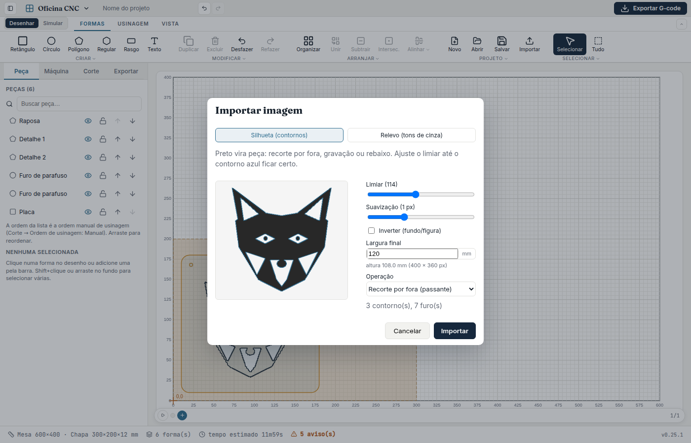
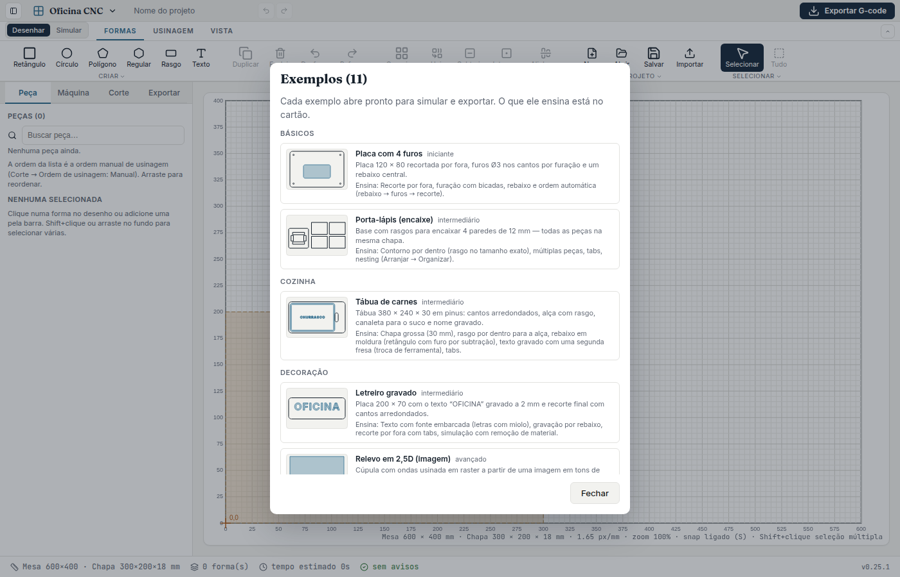
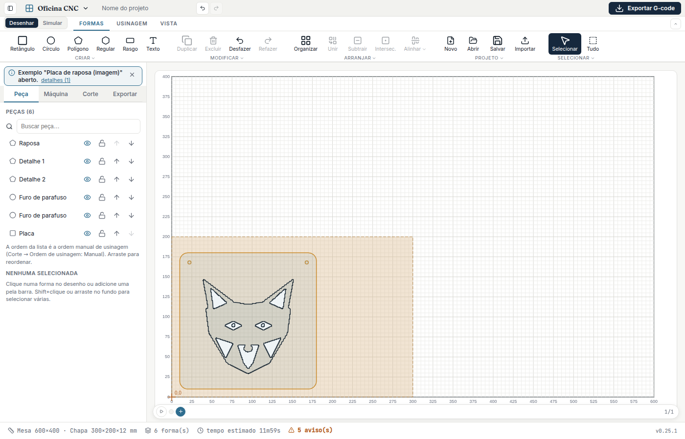
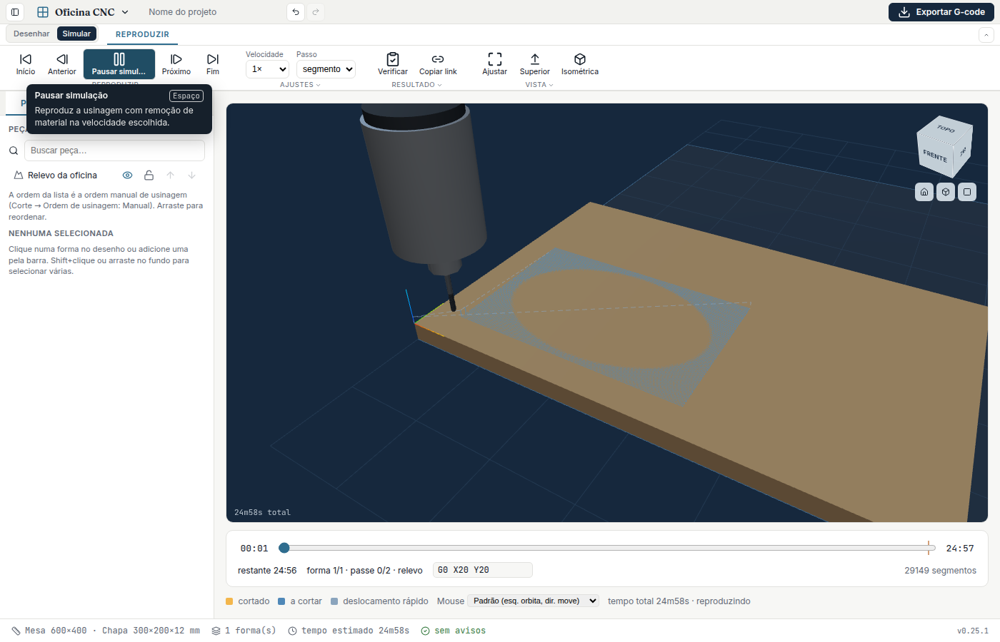

# Sprint 25 — Importar imagem (PNG/JPG): silhueta vetorizada e relevo (heightmap)

**Status:** concluída — 2026-08-16 · **Versão:** 0.26.0
**Esforço:** G (6–8 dias)
**Depende de:** 24

## Origem (feedback do autor, 2026-08-16)
- Os escudos (São Paulo, Palmeiras, Corinthians) e o gato/raposa dos exemplos ficaram simplificados demais. Sugestão: pegar um PNG, converter para preto e branco e usar como heightmap.
- **Sobre os escudos oficiais**: os brasões dos clubes são marcas registradas — não vamos embutir a arte oficial (nem SVG, nem PNG) no app. O que dá para fazer, e é o que esta sprint entrega, é a **ferramenta**: o usuário importa a imagem que tem em casa (o escudo do time dele, a foto do gato) e o app transforma em peça. Os exemplos continuam com desenhos próprios (podem ganhar mais detalhe), e um exemplo demonstra o fluxo com uma imagem nossa.

## Proposta
### A. Importar imagem → **silhueta** (contornos vetoriais)
- Menu/ribbon **Importar** aceita `png/jpg/webp/bmp` (além de SVG/DXF). Diálogo **Importar imagem** com pré-visualização e três controles: **limiar** (0–255, com Otsu como padrão), **inverter**, **suavização** (0–3 px) e **largura final em mm** (mantém proporção); opção "remover ilhas < X mm²".
- `lib/imageTrace.ts`: carrega em `<canvas>` (offscreen), converte para cinza, limiar → bitmap; **marching squares** para extrair contornos (com furos), **Douglas-Peucker** (tolerância 0,1–0,3 mm) para simplificar, `nestLoops` (já existe em `lib/text.ts`) para classificar outer/holes → `PathShape[]` com `holes`, prontos para recorte por fora / rebaixo / gravação. Sem dependência nova (não usar potrace).
- Resultado entra como peças normais (nome = arquivo), com aviso do nº de contornos e da suavização aplicada.

### B. Importar imagem → **relevo** (heightmap 2.5D)
- Mesmo diálogo, modo **Relevo**: cinza → profundidade (branco = 0, preto = profundidade máx., inversível, curva gama), **resolução em mm/px** (0,25–1), **fresa esférica** recomendada, **stepover** e direção (linhas em X, em Y ou cruzado).
- Novo tipo de peça `ReliefShape` (`kind: "relief"`: `x, y, width, height, depthMax, data: Uint8Array (largura×altura), cols, rows, invert, gamma`) — armazenado comprimido (base64 de PNG cinza) no projeto e no link. Editor mostra a miniatura em cinza no lugar; navegador/lista/nesting tratam pela caixa envolvente.
- `lib/toolpath.ts`: operação **relief** → percurso raster: linhas paralelas com stepover; Z por linha calculado da altura amostrada com o **perfil da fresa** (esférica: subtração da esfera; reta: máximo na janela) → G1 X Y Z contínuos (segmentos por pixel/mm), passe de desbaste opcional (raster em Z limitado a `passDepth`) + acabamento. Simulador já usa heightmap → funciona.
- Verificação: compara heightmap final com o alvo (já existe) → "não alcançado" para relevo também.

### C. Exemplos e ajustes
- Exemplo **"Relevo: nossa marca"** (imagem própria em `public/examples/relevo-oficina.png`, 300 × 200 px) e **"Silhueta: raposa (PNG)"** (bitmap próprio mais detalhado que o SVG atual) — mostram os dois fluxos. Gato/raposa SVG atuais ganham mais detalhe (bigodes, pelos) na mesma sprint.
- Escudos: manter geométricos (são exemplos de **níveis/booleanas**, não de fidelidade); texto do card deixa isso claro e aponta "quer o escudo real? importe a imagem do seu time (Importar imagem)".

### D. Percurso de rebaixo (continuação da correção desta rodada)
- Já corrigido nesta rodada: **zigzag por região** (linhas seguem a mesma "faixa" contínua; anel/U não sobem e descem a cada linha — tábua: 51 → 6 mergulhos, 11,8 → 4,8 min).
- Nesta sprint: estratégia **contorno paralelo** (`pocketStrategy: "zigzag" | "contour"`, padrão contorno para regiões com furos/anéis): offsets sucessivos da região (Clipper com furos) de dentro para fora, ligação por avanço entre anéis vizinhos, passe de parede no fim; ilustração no painel (Sprint 24 C) e comparação de tempo no teste da tábua.

## Modelo
```ts
type ShapeKind = … | "relief";
interface ReliefShape extends BaseShape { kind: "relief"; x; y; width; height; cols; rows; data: string /* png cinza base64 */; depthMax; invert; gamma; direction: "x" | "y" | "cross" }
interface MachineSettings { …; pocketStrategy: "zigzag" | "contour" }   // v8
lib/imageTrace.ts: traceBitmap(gray: Uint8Array, w, h, { threshold, invert, blur, tolerance, minArea }): { outer: Point[]; holes: Point[][] }[]
lib/relief.ts: reliefToolpath(shape, settings, tool): Segment[]
```

## Tarefas
- [x] A — importação de imagem → silhueta: `lib/imageTrace.ts` (cinza, Otsu, suavização por caixa, limiar, contornos por rastreio de borda com furos, Douglas-Peucker fechado, `regionsToMm`), diálogo `ImportImageDialog` (pré-visualização com contorno azul, limiar/suavização/inverter/largura/operação, contagem de contornos e furos). Testes: `imageTrace.test.ts` (círculo com furo, letra, Otsu, PGM).
- [x] B — relevo: `ReliefShape` (grade em base64, `depthMax`, `invert`, `gamma`, `direction`, `lineStep`), `lib/relief.ts` (amostragem bilinear, compensação do perfil da fresa reta/esférica/V), `toolpath.relief` (desbaste em passes limitados a `passDepth` + acabamento, G1 contínuo), miniatura em cinza no editor, campos no painel, navegador/histórico/nesting/simulador. Testes: `relief.test.ts`.
- [x] C — exemplos **Placa de raposa (imagem)** (PGM próprio vetorizado → rebaixos com ilhas numa placa) e **Relevo em 2,5D (imagem)** (cúpula com ondas, fresa esférica); cards dos escudos avisam que a arte oficial é marca registrada e apontam para Importar; categoria "Importados (SVG e imagem)". Menu **Exemplos…** abre a galeria direto (submenu removido).
- [x] D — `pocketStrategy: "contour" | "zigzag"` (v8: projetos antigos com peças ficam em zigzag; novos usam contorno), `offsetRegion` (Clipper com furos), `pocketContour` (anéis de dentro para fora, 1 mergulho por passe), opção + ilustração no painel Corte, testes de mergulhos (círculo, moldura).
- [x] Docs, CHANGELOG 0.26.0, sample `sprint25-contorno-relevo.gcode`, screenshots, a11y (diálogo usa `Dialog`).

## Como ficou
- Exemplos embarcados usam **PGM** (cinza binário) em `public/examples/*.pgm` — o mesmo pipeline do diálogo, sem decodificador de PNG no Node (os testes constroem todos os exemplos). Os PNGs equivalentes ficam ao lado para quem quiser testar o "Importar".
- Relevo mantém a grade ≤ 400 px de largura; a peça é tratada pela caixa envolvente no navegador/nesting.
- Estratégia de rebaixo é do projeto (painel Corte), não da peça.

## Screenshots





## DoD específica
- PNG preto e branco de um logotipo vira peças com furos em ≤ 2 s (1000 × 1000 px) e recorta/grava sem cortes fora (verificação 0 mm²).
- Foto em cinza vira relevo que simula com remoção de material e exporta G-code contínuo (sem mergulhos a cada linha).
- Tábua de carnes: contorno paralelo ≤ zigzag em tempo e mergulhos.
