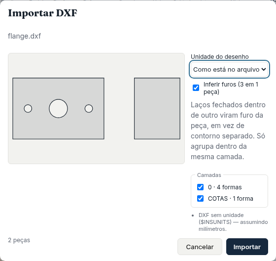
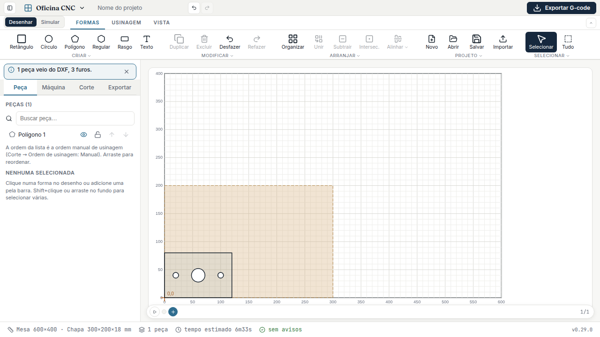
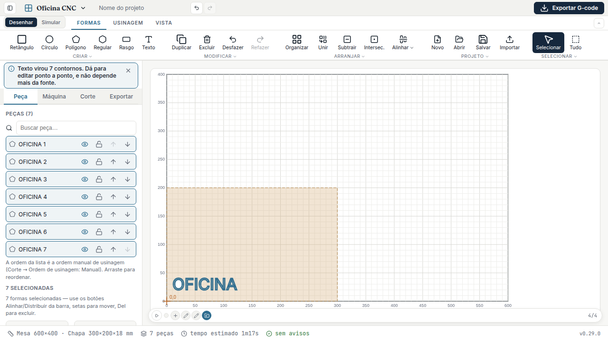

# Sprint 28 — Traga seu desenho

**Status:** concluída — 2026-08-22 · **Versão:** 0.29.0
**Esforço:** M/G (5–7 dias)
**Depende de:** 13 (ilhas e texto), 25 (importação)

## Origem (conversa com o autor, 2026-08-22)

O projeto foi publicado e o post no LinkedIn está no ar; a próxima leva de gente que chegar vem com **desenho próprio na mão**, não com vontade de desenhar do zero. Hoje o caminho de quem já tem um DXF pronto trava logo na entrada: os furos viram contornos soltos e a peça sai errada. E quem quer texto está preso às duas fontes embutidas.

Web Serial (Sprint 17) fica de fora de propósito — é o item mais caro do backlog e só faz sentido quando houver gente usando pra valer.

Fecha os itens **5** (furos no DXF) e **4** (fontes do usuário + explodir texto) do [`fase-5.md`](fase-5.md).

## Proposta

### A. Furos inferidos no DXF

Hoje `parseDxf` empurra cada laço fechado como um `path` independente com `operation: "outline"`. Um flange com 6 furos vira 7 contornos soltos: o percurso corta os furos como peças, não como furos, e a compensação de fresa sai pro lado errado.

O SVG já resolve isso com `nestLoops` (`lib/text.ts`, usado também pelo `imageTrace`): laços em profundidade par viram `outer`, ímpar viram `holes` do menor `outer` que os contém. A mesma função serve aqui.

A diferença é o escopo. No SVG os sub-caminhos vêm dentro de um mesmo `<path>`, então a vizinhança é explícita. No DXF cada laço é uma entidade separada e o agrupamento vira **heurística sobre o arquivo inteiro** — o que é exatamente onde isso dá errado:

- **Moldura**: muito DXF de marcenaria traz um retângulo de borda em volta de tudo. Sem guarda, ele vira o `outer` e a peça inteira vira furo dele.
- **Camadas**: cotas, hachuras e linhas de centro convivem com o contorno. Agrupar através de camadas mistura o que não deve.
- **Peças lado a lado**: duas peças no mesmo arquivo não podem virar uma peça com furo.

Regras adotadas:

1. Só laços **fechados** entram no agrupamento; abertos continuam `path` aberto como hoje.
2. O agrupamento acontece **por camada** (`layer` da entidade). Nada de aninhar entre camadas.
3. Se o laço mais externo de uma camada contiver **todos** os outros e for aproximadamente retangular dentro de 2 % dos limites do desenho, ele é tratado como **moldura**: fica de fora do agrupamento e vira aviso ("essa borda parece uma moldura — importei ela como contorno solto").
4. Aninhamento de 3+ níveis já sai certo do `nestLoops` (ilha dentro de furo volta a ser peça).

### B. Diálogo de importação (DXF/SVG)

A importação hoje é cega: escolhe o arquivo e as formas caem na chapa. Com heurística de furo isso fica pior — se ela errar, a pessoa não sabe o que aconteceu.

`ImportDialog` (usando `components/Dialog.tsx`) entre o arquivo e a chapa:

- **Miniatura** do que vai entrar (reaproveita `projectThumbnail`), furos em tom diferente do contorno.
- **Camadas** com caixa de seleção e contagem ("COTAS · 14 formas"), desmarcadas não importam.
- **Unidade**: o que veio do `$INSUNITS` já resolvido, com opção de sobrescrever (o aviso de "DXF sem unidade" vira um seletor, não um texto).
- **Inferir furos** ligado por padrão, com a contagem ao lado ("6 furos"). Desligar recalcula a miniatura na hora.
- Avisos do parser listados ali, não num notice que some.

Vale pro SVG também — o mesmo diálogo, sem a parte de camadas.

### C. Fontes do usuário (.ttf/.otf)

`registerFont(id, data, label)` já existe e já aceita fonte em tempo de execução; falta a entrada e a permanência.

- Upload no seletor de fonte do painel (item "Carregar fonte…"), aceitando `.ttf`/`.otf`. Nome do arquivo vira o rótulo; falha de parse dá recado da oficina, não stack trace.
- **Permanência em IndexedDB** (`fonts` store, chave = `fontId`), não no `localStorage`: um `.ttf` tem centenas de KB e o projeto persistido já divide espaço com o resto. O projeto guarda só `fontId` + rótulo.
- Ao abrir um projeto cuja fonte não está mais registrada: aviso e volta pra Inter, com ação "carregar a fonte de novo" no próprio aviso. Nada de texto sumir em silêncio.
- **A fonte não viaja**: nem no `.json` exportado, nem no link compartilhado (`share.ts` tem teto de 8 000 caracteres — não cabe, e redistribuir arquivo de fonte é problema de licença que não queremos criar pra ninguém). O caminho pra levar o texto junto é o D.

### D. Explodir texto

`textToPolygons` já devolve `GlyphPolys[]` com `outer` + `holes` — é quase de graça, e é o que fecha o C.

- Item **Explodir texto** no grupo FORMAS da ribbon, ativo com um `text` selecionado.
- Cada glifo vira um `path` fechado com `holes`, preservando `depth`, `operation`, `side`, `tabs` e `extraOps` da peça original. Um `undo` desfaz tudo de uma vez.
- Depois de explodir dá pra editar ponto a ponto, aplicar booleanas e compartilhar por link sem depender de fonte nenhuma.
- O aviso de fonte faltando (C) sugere explodir antes de exportar.

### E. Tom dos recados de importação

`useProjectActions` ainda diz "Não foi possível importar esse arquivo DXF." e "3 forma(s) importada(s)" — as duas coisas que o `AGENTS.md` manda evitar. Passam a "Esse DXF não abriu." e "3 formas importadas do DXF, 6 furos." Varrer os textos de importação junto.

## Modelo

```ts
// lib/dxfImport.ts
interface DxfImportOptions { depth?: number; tolerance?: number; inferHoles?: boolean; layers?: string[] }
interface DxfImportResult { shapes: Shape[]; warnings: string[]; layers: { name: string; count: number }[]; holes: number }
function groupLoopsByLayer(entities, opts): Shape[]   // nestLoops por camada + guarda de moldura

// lib/userFonts.ts
async function saveUserFont(id: string, data: ArrayBuffer, label: string): Promise<void>  // IndexedDB
async function loadUserFonts(): Promise<void>                                            // chama registerFont
function missingFonts(shapes: Shape[]): string[]

// lib/text.ts
function explodeText(shape: TextShape, tol?: number): PathShape[]
```

## Tarefas

- [x] A — `inferHoles` + `groupLoopsByLayer` em `dxfImport.ts` (reusa `nestLoops`), guarda de moldura, `layers`/`holes`/`unitScale`; 8 testes (flange, duas peças, moldura, chapa que *parece* moldura, camadas, `options.layers`, ilha dentro do furo, `isFrameLoop`).
- [x] B — `ImportVectorDialog` (prévia, camadas, unidade, inferir furos, avisos) para DXF e SVG, disparado por `uiStore.vectorFile`; 8 testes de componente + `e2e/sprint28.spec.ts` + axe.
- [x] C — `lib/userFonts.ts` (IndexedDB, `fake-indexeddb` nos testes), "Carregar fonte…" no seletor de fonte, aviso de fonte faltando no painel e ao abrir um `.json`.
- [x] D — `explodeText` (`lib/text.ts`) + `explodeTextShape` no store + botão na seção de texto do painel; testes de lib, de store e e2e.
- [x] E — textos de importação, nesting e booleanas no tom da oficina; varredura de `(s)` e "não foi possível" em `src/` e `e2e/`.
- [x] Docs: README, CHANGELOG 0.29.0, `docs/sprints/README.md`, screenshots, a11y do diálogo novo (axe).

## DoD específica

- DXF de flange com furos importa como **uma** peça com `holes` — percurso compensa pra dentro nos furos e pra fora no contorno (conferir no simulador e no sample de G-code).
- DXF com moldura não transforma a peça em furo da moldura; sai o aviso.
- Camadas desmarcadas no diálogo não entram no projeto.
- Fonte carregada pelo usuário sobrevive a recarregar a página; projeto aberto sem ela avisa e não perde o texto.
- Explodir texto preserva profundidade/operação/tabs e é desfeito com um `undo`.
- `e2e/inp.spec.ts` continua < 200 ms com CPU 4× (o diálogo de importação **não** pode construir miniatura no clique — mesma regra da galeria).
- Sem regressão nos e2e; cobertura nos thresholds.

## O que mudou em relação ao plano

**A guarda de moldura teve de ser reescrita.** A regra planejada — "o laço mais externo contém todos os outros e é aproximadamente retangular" — descreve com igual precisão uma moldura e **uma chapa retangular com furos**, que é o caso mais comum de todos. Na primeira execução ela transformou o flange de teste em "moldura + 3 círculos soltos": exatamente o estrago que a sprint existia para evitar.

O que separa os dois casos não é a forma, é o conteúdo. Uma moldura envolve **peças acabadas**; uma chapa tem só furos. A regra final é: retangular, contém tudo, e o que está dentro forma **duas ou mais peças, pelo menos uma com furo próprio**. O caso do meio — moldura em volta de uma peça só — fica sem detecção de propósito: é geometricamente indistinguível de uma chapa com um rasgo, e chutar ali quebraria peças reais. A chave "inferir furos" no diálogo cobre esse caso. `isFrameLoop` documenta o raciocínio e tem teste para cada ramo.

**"Explodir texto" saiu da ribbon.** Como item da ribbon (em Modificar ou em Arranjar), a largura extra empurrava a barra inteira para o modo compacto a 1280 px — todos os grupos perdiam o rótulo e passavam a só ícone. Não vale trocar a legibilidade permanente da ribbon por uma ação ocasional. O botão foi para a seção de texto do painel: só aparece com um texto selecionado, ao lado dos campos que a pessoa já está mexendo, e custa zero de ribbon.

**O diálogo virou o único caminho de importação.** Estava no plano como item B, mas na prática ele substituiu o fluxo antigo em vez de somar: `handleSvgFile` só lê o arquivo e abre o diálogo, e todo o parse (e o re-parse a cada mudança de opção) acontece lá dentro.

## Fora do escopo

- Web Serial (Sprint 17) — segue na Fase 5.
- Embutir a fonte no `.json` ou no link (resolvido por "Explodir texto").
- NFP, G2/G3 e i18n — próximas candidatas.

## Como ficou

- `parseDxf` devolve `{ shapes, warnings, layers, holes }`. `inferHoles` (padrão ligado), `layers` e `unitScale` controlam o resultado; `groupLoopsByLayer` e `isFrameLoop` são exportados e testados à parte.
- Importar passa por `uiStore.vectorFile` → `ImportVectorDialog`. Nada entra na chapa antes de confirmar, e a prévia usa `projectThumbnail` (mesma função das miniaturas da galeria) — sem construir nada pesado no clique.
- Fonte do usuário: `addUserFont` registra e grava em IndexedDB (`oficina-cnc/fonts`); `loadUserFonts()` roda no `main.tsx` junto com as embutidas. A fonte **não** viaja no `.json` nem no link — `missingFonts` avisa e o texto cai na Inter até a fonte voltar.
- `explodeText(shape)` devolve `PathShape[]` com `holes`, ids próprios (inclusive das operações extras) e a mesma geometria que o `expand` já usinava — teste confere que o percurso antes e depois é idêntico.

## Ajuste pós-sprint (sincronização com o repositório local, 2026-08-22)

A sprint foi executada na nuvem enquanto o repositório local tinha uma revisão de tom da UI inteira que nunca tinha sido sincronizada de volta (avisos, erros, Sobre e dicas no tom da oficina, BrandMark, SEO, `@vercel/analytics`, fonte Bricolage). A mesclagem tomou **o texto local como base** — a tarefa E desta sprint tinha refeito o mesmo trabalho com outras palavras, e a voz que vale é a revisada — e reaplicou por cima só o que é específico da Sprint 28. Três conflitos reais saíram dessa reconciliação:

- **Título da aba**: o nome do projeto (Sprint 22) e a vista (`e2e/seo.spec.ts`) disputavam o `document.title`. Regra adotada: projeto com nome ganha; sem nome, cai para a vista ("Desenhar — Oficina CNC") em vez de "Sem nome".
- **Altura da barra**: o wordmark Bricolage custa ~2 px; o limite do `e2e/toolbar.spec.ts` subiu de 130 para 134 px, com o motivo comentado no teste.
- **Specs desatualizadas**: quatro e2e locais cobravam textos que o próprio app local já não usava; foram alinhadas. O índice das sprints tinha linhas duplicadas (23, 24, 26, 27) de uma mesclagem anterior; deduplicado.

## Screenshots


*Prévia com furo desenhado como vazio (preenchimento even-odd), camadas com contagem, unidade e a chave de inferir furos.*


*O mesmo arquivo na chapa: uma peça com três furos, não quatro contornos soltos.*


*"OFICINA" virou sete contornos editáveis; os vazios das letras viraram furos.*
