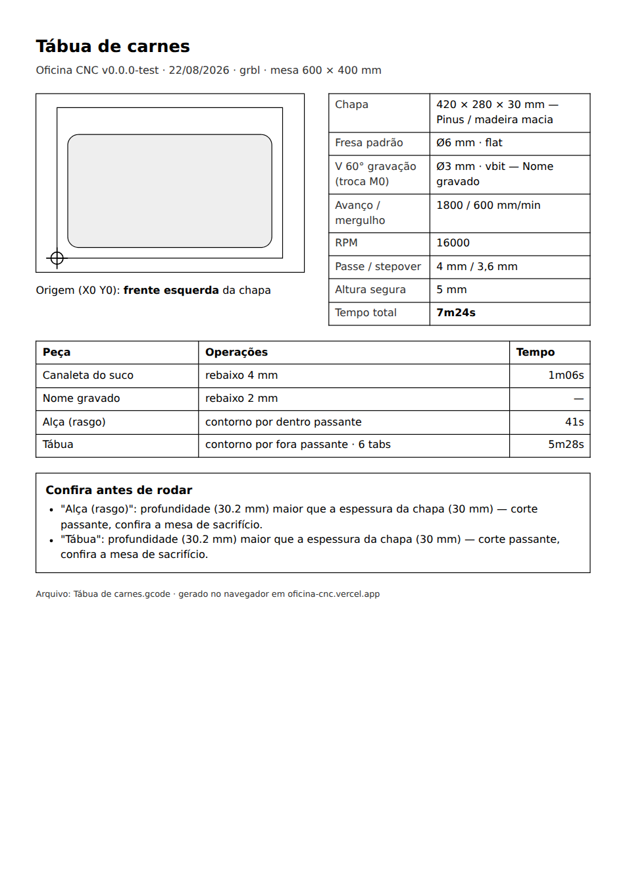
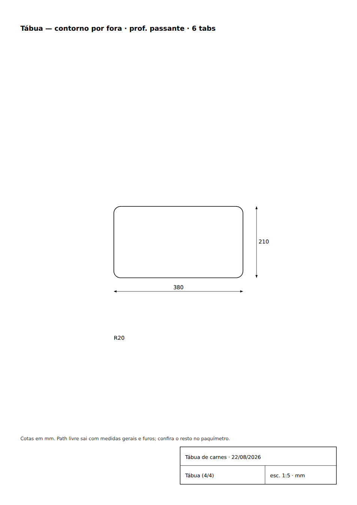
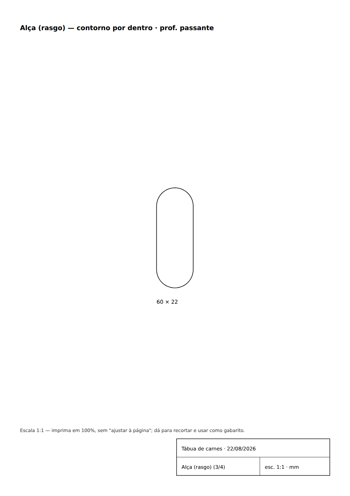
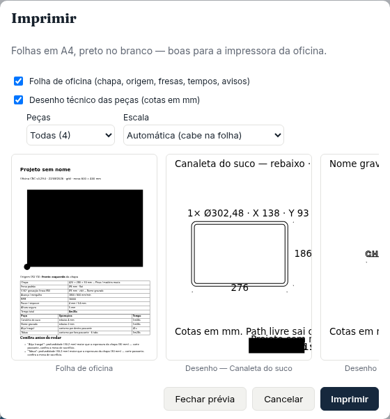
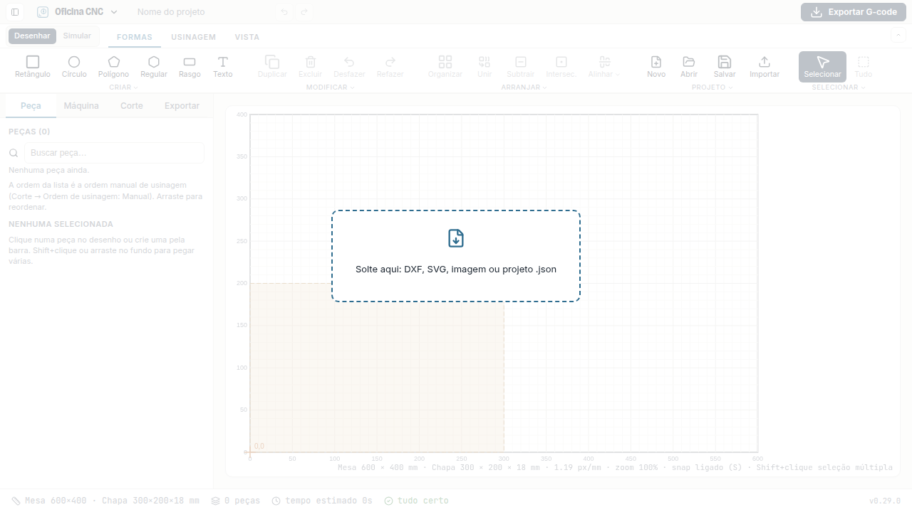

# Sprint 29 — Imprimir (folha de oficina + desenho técnico) e entrada rápida

**Status:** concluída — 2026-08-22 · **Versão:** 0.30.0
**Esforço:** G (6–8 dias)
**Depende de:** 27 (derived), 28 (diálogo de importação)

## Origem (conversa com o autor, 2026-08-22)

Três perguntas guiaram o recorte: o que falta no mobile, onde a cobertura está fina, e que detalhe deixaria o projeto incrível sem conectar no hardware. As respostas viraram esta sprint: papel na oficina (folha de setup e desenho técnico impresso — nenhuma ferramenta gratuita faz isso bem), o gesto de importação que todo mundo tenta primeiro (arrastar o arquivo pra tela), e as pontas soltas da medição de INP e do e2e mobile.

G2/G3 fica para a Sprint 30 — é a mais pesada do backlog e mexe no coração de `toolpath`/`gcode`; não vale dividir atenção com a impressão.

## Proposta

### A. Folha de oficina (setup sheet)

Uma página A4 que a pessoa imprime e cola do lado da máquina antes de rodar o G-code. Tudo que ela contém o app já sabe — é composição, não cálculo novo:

- **Miniatura da chapa** com as peças posicionadas e a **origem de trabalho marcada** (`originPoint` de `lib/toolpath.ts`, com o símbolo ⌀ no ponto e o nome: "canto frontal esquerdo").
- **Tabela de corte**: material, espessura da chapa, fresa (Ø, tipo), avanço, mergulho, RPM, profundidade por passe, stepover — e as fresas extras com as peças que as usam (troca com M0).
- **Peças e operações**: nome, operação (contorno/rebaixo/furação), profundidade, tabs, tempo estimado **por peça** (novo: hoje só existe o total — expor por peça também no navegador entra de brinde nesta tarefa).
- **Avisos** da validação e da Verificação, se houver ("fresa não entra no bolsão X").
- **Rodapé**: nome do projeto, arquivo `.gcode` gerado, pós-processador, versão do app, data.

### B. Desenho técnico 2D com cotas — é possível, sim

A pergunta do autor foi se dá para gerar um desenho técnico da peça. Dá, porque toda a geometria já existe resolvida em mm (`shapeToPoints`, `holes`, `boundingBox`); o que falta é **decidir o que cotar** — cotagem automática completa é problema de CAD, mas um subconjunto honesto cobre o que a oficina precisa:

- **Cotas gerais** por peça: largura e altura totais (linhas de cota fora da peça, setas e texto no padrão ABNT simplificado).
- **Furos circulares**: Ø de cada tamanho, agrupados ("4× Ø5"); posição do centro do primeiro furo de cada grupo a partir do canto inferior esquerdo da peça (X e Y). Furos não circulares (rasgos) ganham comprimento × largura.
- **Cantos** de retângulo com raio/chanfro: "R6" / "C3" no canto correspondente.
- **Legenda por peça**: operação, profundidade (com "passante" quando `cutThrough`), lado da compensação, tabs.
- **Carimbo** (title block) no canto inferior direito: projeto, peça, escala, "mm", data, autor (nome do projeto do `settings.projectName`).
- **Escala**: automática para caber na folha, declarada no carimbo ("esc. 1:2"). E o detalhe que interessa de verdade: **opção 1:1 quando a peça cabe na página** — imprime, recorta e cola na madeira como gabarito. SVG em mm + `@page` sem margens de escala tornam isso confiável (com o aviso "imprima em 100%, sem ajustar à página").
- Peça grande demais para 1:1 numa folha: sai só em escala reduzida nesta sprint (mosaico/tiling multi-página fica no backlog).

O que **não** entra (e o doc deixa claro no rodapé da folha): cotagem de path livre ponto a ponto — path importado/vetorizado ganha só caixa envolvente + furos; cadeia de cotas encadeadas; tolerâncias. É o suficiente para conferir a peça com paquímetro, que é o uso real.

### C. Como imprime

- `lib/sheet.ts` — **puro**: `setupSheet(shapes, settings, derived)` e `technicalDrawing(shape | shapes, settings, opts)` devolvem SVG (string) + metadados (escala usada, páginas). Testável em Node sem navegador, igual `projectThumbnail`.
- `components/PrintDialog.tsx` — diálogo "Imprimir…" no menu do projeto: escolhe folha de oficina, desenho técnico (todas as peças ou a selecionada) e escala (auto / 1:1 quando couber); prévia das páginas; botão Imprimir abre um iframe oculto com `@page A4` e chama `print()`. Nada de `window.open` (popup blocker) nem de depender do CSS do app — a folha leva o próprio CSS inline, preto no branco, sem tema.
- Entrada única na UI: item **Imprimir…** no menu do projeto (`menu-print`), atalho Ctrl+P interceptado quando o editor está focado. Nada novo na ribbon (regra do orçamento de largura do `AGENTS.md`).

### D. Entrada rápida: arrastar e colar

- **Arrastar arquivo para a janela** (editor ou simulador): `.dxf`/`.svg` cai no `ImportVectorDialog` (mesmo caminho do `uiStore.vectorFile`), imagem cai no `ImportImageDialog`, `.json` abre o projeto (com `confirmDialog` se houver peças não salvas). Overlay "solte aqui" (`drop-overlay`) enquanto arrasta; múltiplos arquivos: primeiro vale, aviso para o resto.
- **Colar** (Ctrl+V): imagem do clipboard entra como no import de imagem; texto que parece SVG (`<svg`) entra como SVG.
- Tudo passa pelos diálogos existentes — arrastar não pula a prévia da Sprint 28.

### E. Medição e mobile — pontas da Sprint 27

- **Rota "Unknown" no Speed Insights**: hoje 135 dos 183 pontos de desktop caem sem rota, porque `<SpeedInsights route={...}>` só resolve depois da view montar. Rota inicial explícita (`/editor`) e a troca continua no clique. Sem isso, a meta "INP P75 < 200 no mobile" não tem número confiável para ser cobrada.
- **e2e mobile do diálogo de importação**: abrir DXF no Pixel 7, conferir que o diálogo cabe (grid colapsa < 768 px), toggle de furos funciona por toque e a importação conclui. Mesmo teste para o PrintDialog (prévia rola, não estoura a tela).
- Se a janela limpa do Speed Insights (após ~24/08) mantiver INP P75 > 200 no mobile: montagem da cena Three.js em passos (`requestAnimationFrame`) entra como ajuste pós-sprint; senão, não mexer.

### F. Cobertura — folga no threshold

- Branch global está a 0,36 pt do threshold (75,36 % vs 75). Testes dirigidos no `SidePanel` (abas máquina/corte/exportar: presets, overrides, operações extras via UI) para criar folga real — meta ≥ 77 % branches.
- **Corpus DXF real**: fixtures exportados de CAD de verdade (Fusion 360, LibreCAD, QCAD — o autor fornece os seus), rodados contra `parseDxf` num teste de fumaça ("abre sem exceção, ≥ 1 peça, unidade certa"). É onde os bugs de parser realmente moram; os fixtures atuais são todos sintéticos.

## Modelo

```ts
// lib/sheet.ts (puro, sem React)
interface SheetPage { svg: string; title: string }
interface SheetOptions { paper?: "a4"; scale?: number | "auto" | "1:1" }
function setupSheet(shapes: Shape[], settings: MachineSettings, derived: DerivedData): SheetPage
function technicalDrawing(shapes: Shape[], settings: MachineSettings, opts?: SheetOptions): SheetPage[]  // 1 página por peça
function fitScale(bboxMm: Box, paperMm: Box): { scale: number; label: string }   // "1:1", "1:2", "1:5"…
function dimensionsFor(shape: Shape): Dimension[]  // cotas: gerais, furos agrupados, cantos

// state/uiStore.ts
printOpen: boolean  // diálogo Imprimir…

// tempo por peça: derivedCompute passa a devolver também timePerShape: Record<string, number>
```

## Tarefas

- [x] A — `setupSheet` em `lib/sheet.ts` + `timePerShape` no `derivedCompute` (mostrado no navegador de peças); testes (origem, fresas extras com as peças, avisos, tempo por peça ≤ total).
- [x] B — `dimensionsFor` + `technicalDrawing` + `fitScale` com 1:1 (e recuo automático quando 1:1 não cabe); testes com flange (3× Ø10 + posição + rasgo), fillet (R6), círculo (Ø), rasgo, página em mm.
- [x] C — `PrintDialog` (prévia por página, folhas e escala, iframe com `SHEET_CSS` próprio), `menu-print` + Ctrl+P interceptado; 4 testes de componente + axe + screenshots.
- [x] D — `importEntry.ts` (porta única: menu, drop e colar caem nos mesmos diálogos), `DropImport` com overlay e contador de profundidade; 9 testes de roteamento + e2e com `DataTransfer` real.
- [x] E — Speed Insights injetado no `main.tsx` com rota definida antes do React montar (`setRoute` na troca de vista); e2e mobile: importar DXF por toque e prévia de impressão sem estourar a tela.
- [x] F — 14 testes do `SidePanel` (máquina/corte/exportação/peça) + BottomSheet + uiStore + userFonts sem IndexedDB → branches 77,2 %; corpus DXF estilo LibreCAD (POLYLINE antiga + camadas), Fusion (bulge + polegadas + INSERT) e QCAD (spline/elipse) com fumaça automática por arquivo.
- [x] Docs: README, CHANGELOG 0.30.0, `docs/sprints/README.md`, screenshots (folha, desenhos, diálogo, overlay).

## DoD específica

- Folha de setup imprime em 1 página A4 com origem, fresas (inclusive extras), tempos por peça e avisos; sem cor obrigatória (legível em impressora P&B).
- Desenho técnico do flange de teste sai com largura, altura, "3× Ø10" e posição do primeiro furo; carimbo com escala correta.
- Em escala 1:1, um retângulo de 100 mm impresso mede 100 mm (conferido com régua na impressão real — o autor valida; o teste automatizado confere o atributo `width` em mm do SVG e o `@page`).
- Arrastar um DXF para o editor abre o diálogo de importação da Sprint 28 — nunca importa direto.
- Rota "Unknown" some dos novos dados do Speed Insights (conferir no painel após deploy).
- Branches ≥ 77 %; e2e mobile passam; `e2e/inp.spec.ts` continua < 200 ms (o PrintDialog não constrói SVG no clique de abrir — só quando a prévia é pedida).
- Sem regressão nos e2e; DoD global do `AGENTS.md`.

## Como ficou

- `lib/sheet.ts` devolve `SheetPage[]` (HTML autocontido por página A4, SVG onde há desenho) + `SHEET_CSS`; tudo em **mm de verdade** (`viewBox` em mm, `width:210mm`) — é isso que faz o 1:1 sair certo na impressora em 100%.
- Furos são reconhecidos por geometria (`isCircleLoop`: pontos equidistantes do centroide) e agrupados por diâmetro ("3× Ø10" + posição do primeiro a partir do canto); furo não circular sai como comprimento × largura. Path livre: medidas gerais + furos, e o rodapé da folha avisa que o resto se confere no paquímetro.
- O corpus de DXF reais fica em `src/lib/__tests__/fixtures/real/` — **solte qualquer `.dxf` exportado do seu CAD lá e o teste de fumaça o adota automaticamente** (abre sem exceção, ≥ 1 peça, coordenadas finitas).
- Speed Insights: o script agora nasce com `data-route` definida; medições pré-hidratação deixam de cair como "Unknown". Conferir no painel após o deploy.
- A tarefa do plano "montagem da cena Three.js em passos" segue condicionada: só se o INP P75 mobile continuar > 200 ms com a janela limpa de dados.

## Fora do escopo

- Mosaico multi-página para 1:1 de peça grande (backlog).
- Cotagem completa de path ponto a ponto, cadeias de cota, tolerâncias.
- PDF gerado pelo app (imprimir → "salvar como PDF" do navegador já resolve).
- G2/G3 — Sprint 30.
- Web Serial — segue na Fase 5.

## Screenshots


*Folha de setup da tábua de carnes: chapa com origem, fresas (com a troca M0), tempos por peça e a seção "confira antes de rodar".*


*Desenho cotado (380 × 210, R20) com carimbo e escala 1:5.*


*Peça pequena sai em escala 1:1 — recorta e usa como gabarito.*



