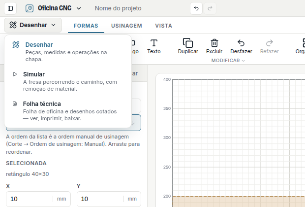
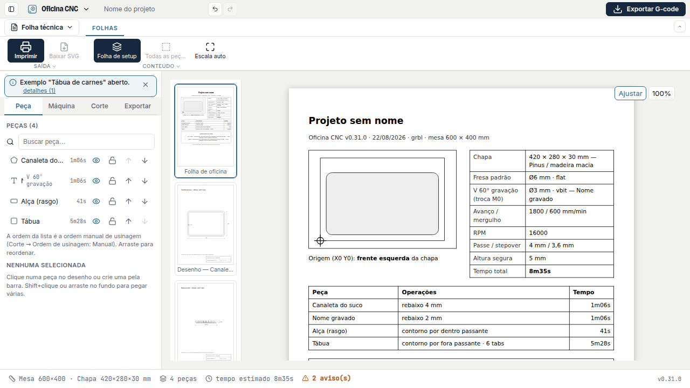
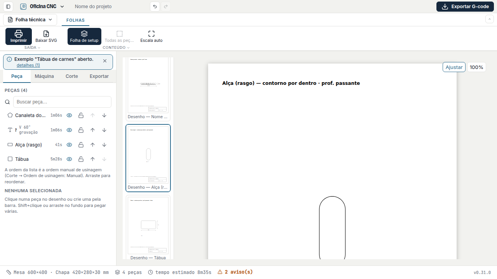

# Sprint 30 — Estações de trabalho e folha técnica na tela

**Status:** concluída — 2026-08-22 · **Versão:** 0.31.0
**Esforço:** G (6–8 dias)
**Depende de:** 29 (lib/sheet), 22 (barra Fusion)

## Origem (conversa com o autor, 2026-08-22, com referências do Fusion 360)

O autor mandou telas do Fusion 360 com três pedidos: (1) trocar o switch **Desenhar | Simular** por um **dropdown de estação de trabalho** como o "DESIGN ▾" do Fusion, com a folha técnica virando uma estação própria; (2) uma **tela de desenho técnico** — ver as folhas antes de exportar, "no futuro, podemos até editar"; (3) a pergunta sobre **análise de resistência** na simulação (respondida na seção D — vira a Sprint 31).

De quebra: subir a cobertura de novo, com e2e e smoke além de unitários (seção C).

## Proposta

### A. Dropdown de estações (estilo Fusion)

- `View` ganha um terceiro valor: `"editor" | "simulator" | "drawing"`.
- No lugar dos dois botões de aba, um **dropdown** no canto da barra (como o "DESIGN ▾" do Fusion): rótulo da estação atual + menu com as três. Test ids `workspace-menu`, `ws-editor`, `ws-simulator`, `ws-drawing`.
- Nomes em pt-BR (o "traduzir de acordo com o nosso l10n" do autor): **Desenhar**, **Simular**, **Folha técnica**. "Folha técnica" em vez de "Desenho" para não confundir com "Desenhar" — e é o nome que o autor usou ao pedir a funcionalidade.
- As abas de contexto e a ribbon continuam por estação, como hoje (FORMAS/USINAGEM/VISTA · REPRODUZIR · e a nova FOLHAS).
- Mobile: a `BottomBar` ganha o terceiro destino; a estação de folha no celular é só visualização + imprimir.
- `document.title` e a rota do Speed Insights acompanham (`/folha`).

### B. Estação "Folha técnica" — ver antes de exportar

A prévia pequena do diálogo vira uma tela de verdade, no modelo da referência (Fusion Drawing):

- **Miniaturas das páginas** numa coluna (folha de oficina + um desenho por peça), página atual em destaque.
- **Página central** renderizada grande (o SVG/HTML de `lib/sheet.ts`, que já existe), com zoom ajustar/100%.
- **Ribbon FOLHAS**: escolher o que entra (folha de oficina, desenhos, todas/só a selecionada), escala (auto / 1:1), **Imprimir** (mesmo iframe da Sprint 29) e **Baixar SVG** da página atual (o arquivo vetorial serve para editar fora, plotter, laser).
- As páginas recalculam quando o projeto muda (mesma regra do derived: nada pesado no clique de trocar de estação — gerar em `requestIdleCallback` ou ao entrar na estação, com placeholder).
- **O `PrintDialog` sai**: Ctrl+P e o item Imprimir… do menu passam a levar à estação. Um diálogo e uma estação com o mesmo conteúdo seria duplicação — os testes do diálogo migram para a estação.
- Editar cotas/vistas na tela fica registrado como futuro (fora do escopo).

### C. Cobertura: subir o sarrafo e segurar

- **Thresholds sobem**: linhas 80 → 82, branches 75 → 77 (statements/functions acompanham em 82/80). O que a Sprint 29 conquistou (77,2 % branches) vira piso obrigatório, não conquista solta.
- **`ImportImageDialog` está em 0 %** de cobertura de componente — único diálogo sem teste. Testes com imagem sintética (canvas 2D no jsdom já funciona no projeto via `imageToGray` — usar fixture PGM como nos exemplos).
- **e2e**: spec da estação nova (trocar estação, navegar páginas, baixar SVG, imprimir chega ao iframe), atualização dos specs que citam `tab-simulator` (helper `gotoWorkspace(page, ws)` em `e2e/helpers.ts`), a11y da estação, mobile (BottomBar com 3 destinos).
- **Smoke**: `e2e/smoke.spec.ts` vira o caminho feliz completo — abrir exemplo → editar um campo → simular → folha técnica → exportar G-code — marcado `@smoke` para rodar primeiro no CI.

### D. Análise de resistência — resposta e caminho (Sprint 31)

Três perguntas do autor, três respostas:

**Precisa montar um modelo 3D?** Não. Toda peça do Oficina CNC já **é** um sólido implícito: contorno 2D + furos + espessura da chapa (e rebaixos = regiões com outra profundidade). É um sólido de extrusão — o simulador já constrói algo assim para remover material. Uma vista "peça pronta em 3D" (extrusão limpa, sem chapa) é barata e entra como parte da Sprint 31.

**Dá para analisar resistência?** Dá, por fases, sendo honesto sobre o que cada fase responde:

1. **Carga no plano da chapa** (puxar/pender numa alça, suporte de parede carregado para baixo no próprio plano): **FEA 2D plane-stress com espessura** — malha triangular do contorno (com furos), material com módulo E e Poisson por preset (MDF, compensado, pinus, alumínio), apoios e cargas aplicados em arestas, mapa de tensão de von Mises colorido como a referência do Fusion. Isso é FEM clássico, roda em Web Worker, e é validável contra casos analíticos (placa com furo: concentração ≈ 3×; viga engastada).
2. **Carga fora do plano** (prateleira vergando com peso em cima): modelo de **placa/viga** — para os casos comuns de marcenaria, a fórmula de viga (vão, seção, E) responde "quantos mm essa prateleira cede com 20 kg" com precisão suficiente; placa completa (elementos DKT) fica para depois se o feedback pedir.
3. Um aviso permanente na tela: **números orientativos** — madeira varia de chapa para chapa, e isso não substitui norma nem engenheiro para nada estrutural de verdade.

**Onde fica?** Estação própria ("Resistência"), como no Fusion — entra no dropdown da tarefa A quando a Sprint 31 chegar. Materiais ganham E/Poisson/densidade nos presets.

Esta sprint só deixa o terreno pronto (dropdown extensível); a análise em si é a Sprint 31, que já nasce com este plano de referência.

## Modelo

```ts
// state/uiStore.ts
type View = "editor" | "simulator" | "drawing";

// state/sheets.ts (novo, mesmo padrão do derived)
interface SheetsState { pages: SheetPage[]; current: number; scale: "auto" | "1:1"; scope: "all" | "selected"; status: "idle" | "building" | "ready" }
// recalcula por projectHash quando a estação está ativa; nunca no clique

// components/DrawingWorkspace.tsx — miniaturas + página + zoom
// e2e/helpers.ts
async function gotoWorkspace(page: Page, ws: "editor" | "simulator" | "drawing"): Promise<void>
```

## Tarefas

- [x] A — `View` com `"drawing"`, dropdown `workspace-menu` + `WorkspaceMenu` (rótulo, ícone e descrição por estação), `BottomBar` com navegação de página e Imprimir no celular; `document.title` e rota `/folha`; 20 usos de `tab-*` migrados para `gotoWorkspace` (helper novo em `e2e/helpers.ts`); passo do tour atualizado.
- [x] B — `state/sheets.ts` (hash projeto+opções, montagem em idle com placeholder — 80 ms o toque de abrir com CPU 4×) + `DrawingWorkspace`; ribbon FOLHAS (Imprimir, Baixar SVG com `standaloneSvg`, folha de setup, escopo, escala); `SCOPED_SHEET_CSS` para o preview em-app não depender de regra global; `PrintDialog` removido; 6 testes de componente; screenshots.
- [x] C — thresholds 82/82/80/77 (cobertura fechou em 91 % linhas / 78,6 % branches); 5 testes do `ImportImageDialog` (imagem sintética + canvas fake); e2e `sprint30.spec.ts` + a11y + mobile; smoke completo (exemplo → editar → simular → folha → G-code).
- [x] D — dropdown extensível pronto; "Resistência" registrado no `fase-5.md` com o plano técnico.
- [x] Docs: README, CHANGELOG 0.31.0, `docs/sprints/README.md`, screenshots.

## DoD específica

- Trocar de estação pelo dropdown < 200 ms com CPU 4× (`inp.spec.ts` ganha o toque "abrir estação de folha" — as páginas montam depois, com placeholder).
- A estação mostra as mesmas páginas que saem na impressão (mesma `lib/sheet.ts` — teste compara o HTML).
- Baixar SVG entrega arquivo que abre no Inkscape (bem-formado, com `viewBox` em mm).
- Ctrl+P leva à estação; imprimir de lá sai idêntico ao da Sprint 29.
- Thresholds novos passam; smoke completo < 60 s no Chromium.
- Sem regressão nos 108 e2e; a11y sem violações; mobile/tablet passam.

## Como ficou

- `isCircleLoop` ganhou a guarda de caixa quadrada: a canaleta da tábua (retângulo arredondado) aparecia como "Ø302" no desenho — agora sai como comprimento × largura. O preview em-app usa `SCOPED_SHEET_CSS` (o `SHEET_CSS` com seletores prefixados), então a folha na tela e a impressa vêm do mesmo CSS.
- O toque "abrir Folha técnica" entrou no `inp.spec.ts`: 80 ms com CPU 4× — as páginas montam em idle, nunca no clique.
- `e2e/inp.spec.ts` passou a `test.setTimeout(240s)`: são 9 toques × 3 rodadas com CPU 4×.

## Fora do escopo

- Editar cotas/vistas na folha (futuro que o autor citou — registrado).
- Análise de resistência (Sprint 31 — plano na seção D).
- PDF nativo (imprimir → salvar como PDF resolve).
- G2/G3 — continua na fila, vira Sprint 32 se a 31 for a Resistência.

## Screenshots




